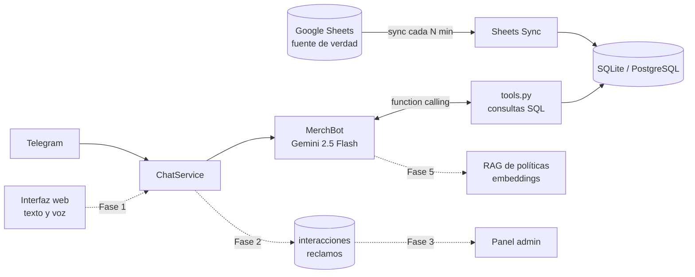

# MerchBot

**Asistente conversacional de inventario para una empresa de merchandising sublimado.** Se le pregunta en lenguaje natural por stock, pedidos y reposición, y responde con datos reales de la base. Los números salen de consultas SQL ejecutadas por *function calling*; el modelo solo redacta.

> Proyecto de portfolio y trabajo final de *Técnicas de Procesamiento del Habla* (Tecnicatura en Ciencia de Datos e IA, IFTS N°18). Nació como un bot de Telegram y está evolucionando a un asistente web disponible 24/7, con voz, RAG y panel de métricas.

<!-- Reemplazar por captura o GIF real cuando termine la Fase 1 -->
<!--  -->

## Demo

```
vos:  cuántas remeras negras M tengo?
bot:  Tenés 100 unidades de Remera Cuello Redondo Negro M.

vos:  qué pidió Coca-Cola?
bot:  Coca-Cola - Evento Verano (15/04):
      • Remera Cuello Redondo Blanco M — 120 unidades
      • Remera Cuello Redondo Blanco L — 80 unidades
      • Gorra Con Respiración Rojo — 40 unidades

vos:  necesito 200 buzos canguro grises L para un evento
bot:  Hoy tenés 30 unidades de Buzo Canguro Gris L. No alcanzan para 200.
      Te paso alternativas con stock disponible:
      • Buzo Canguro Gris XL — 20 unidades
      • Buzo Cuello Redondo Gris L — 50 unidades
```

Los datos de ejemplo son ficticios (`data/Stock_Merchandising_Demo.xlsx`).

## Estado del proyecto

| | Funcionalidad | Estado |
|---|---|---|
| ✅ | Bot de Telegram con whitelist y anti-spam | Hecho |
| ✅ | Function calling contra SQLite (stock, pedidos, resumen, reposición) | Hecho |
| ✅ | Sincronización periódica desde Google Sheets | Hecho |
| ✅ | 98 tests automatizados (Gemini mockeado) | Hecho |
| 🚧 | Interfaz web (FastAPI + HTML) y Docker | Fase 1 |
| 🚧 | Registro de interacciones, hora simulada y reclamos | Fase 2 |
| 🚧 | Panel admin con métricas | Fase 3 |
| 🚧 | Voz (reconocimiento y síntesis) | Fase 4 |
| 🚧 | RAG de políticas y procedimientos | Fase 5 |
| 🚧 | Sentimiento y prioridad de reclamos | Fase 6 |
| 🚧 | Set de evaluación, login y rate limit web | Fase 7 |
| 🚧 | Deploy 24/7 en VPS | Fase 8 |

Detalle de cada fase en [`docs/PLAN_DE_FASES.md`](docs/PLAN_DE_FASES.md).

## Por qué está hecho así

- **El modelo no inventa números.** No se le pasa el catálogo en el prompt: Gemini decide qué función llamar (`buscar_stock`, `obtener_pedidos_de_cliente`, …), el código la ejecuta contra la base y el resultado vuelve al modelo, que arma la respuesta. Escala a miles de SKUs sin tocar el prompt.
- **Solo lectura sobre el negocio.** El bot no modifica stock ni pedidos. La fuente de verdad sigue siendo la planilla que ya usa la empresa.
- **Sin migrar el sistema de nadie.** Sincroniza desde un Google Sheets compartido por el endpoint público de exportación: no necesita OAuth ni cuenta de Google Cloud.
- **Cada capa se puede reemplazar.** La lógica vive en `MerchBot.ask()`; Telegram y la web son interfaces finas por encima.
- **RAG solo donde corresponde (Fase 5).** El stock es dato estructurado y se consulta con SQL. Los embeddings se reservan para texto libre (políticas, preguntas frecuentes).

## Arquitectura



Las líneas punteadas son partes planificadas.

**Flujo de una consulta**

1. El usuario escribe por Telegram.
2. El handler verifica la whitelist y el rate limit.
3. `MerchBot.ask()` envía la consulta a Gemini junto con las funciones disponibles y el historial reciente.
4. Gemini pide ejecutar una o varias funciones; el código las corre contra la base.
5. Gemini redacta la respuesta con esos resultados y se devuelve al usuario.

## Stack

| Capa | Tecnología |
|---|---|
| Lenguaje | Python 3.11 |
| LLM | Google Gemini 2.5 Flash (`google-genai`) con function calling |
| Interfaz actual | python-telegram-bot 21 |
| Base de datos | SQLite (desarrollo) / PostgreSQL (producción), SQLAlchemy 2.0 |
| Sincronización | `requests` sobre el endpoint público de Google Sheets |
| Tareas periódicas | APScheduler |
| Configuración | pydantic-settings |
| Tests | pytest, pytest-asyncio |
| Previsto | FastAPI, Docker, Web Speech API, embeddings de Gemini, `transformers` |

## Funciones que el modelo puede llamar

| Función | Para qué |
|---|---|
| `buscar_stock` | Stock por producto, modelo, color y talle |
| `listar_productos_a_comprar` | Productos con stock en cero o negativo, ordenados por urgencia |
| `obtener_pedidos_de_cliente` | Pedidos de un cliente (búsqueda parcial) |
| `listar_pedidos_recientes` | Últimos N pedidos |
| `obtener_resumen_ejecutivo` | Métricas agregadas de stock y pedidos |
| `listar_categorias_disponibles` | Catálogo disponible |

## Cómo correrlo

### Requisitos

- Python 3.11
- Una API key de [Google AI Studio](https://aistudio.google.com/app/apikey)
- Un bot de Telegram creado con [@BotFather](https://t.me/BotFather)
- Un Google Sheets con las hojas `Stock` y `Pedidos` (usá `data/Stock_Merchandising_Demo.xlsx` como plantilla)

### Instalación

```bash
git clone https://github.com/agustinvignau/merchbot.git
cd merchbot

python -m venv venv
source venv/bin/activate        # Windows: venv\Scripts\activate
pip install -r requirements.txt

cp .env.example .env            # Windows: copy .env.example .env
```

Completá en `.env`:

```
GEMINI_API_KEY=...
TELEGRAM_BOT_TOKEN=...
SHEETS_ID=...                   # el ID del Sheets compartido como "Cualquiera con el enlace - Lector"
TELEGRAM_ALLOWED_USER_IDS=      # vacío al principio; ver más abajo
```

### Probar sin Telegram

```bash
python scripts/test_sync.py            # verifica la sincronización con el Sheets
python scripts/test_bot_interactive.py # conversa con el bot desde la terminal
```

### Arrancar el bot

```bash
python -m src.main
```

### Whitelist (importante)

Sin whitelist, cualquiera que encuentre el bot puede ver el stock y los clientes.

1. Arrancá el bot y escribile `/whoami` para obtener tu ID.
2. Pegalo en `TELEGRAM_ALLOWED_USER_IDS` (varios IDs separados por coma).
3. Reiniciá.

### Comandos

| Comando | Qué hace |
|---|---|
| `/start`, `/help` | Bienvenida y ayuda |
| `/whoami` | Muestra tu ID de Telegram |
| `/sync` | Fuerza la sincronización con el Sheets |
| `/comprar` | Lista lo que hay que reponer (sin IA, directo de la base) |
| `/resumen` | Resumen ejecutivo |
| `/clear` | Borra el historial de la conversación |

## Tests

```bash
pytest
```

98 tests. Usan SQLite en memoria y mockean Gemini, así que no consumen cuota ni requieren claves.

## Estructura

```
merchbot/
├── data/                       # plantilla de demo y script que la genera
├── docs/
│   ├── PLAN_DE_FASES.md        # hoja de ruta detallada
│   └── Propuesta_MerchBot.pdf
├── scripts/                    # prueba de sync y REPL del bot
├── src/
│   ├── config.py               # variables de entorno
│   ├── database.py             # engine SQLAlchemy
│   ├── models.py               # StockItem, Pedido
│   ├── sheets_sync.py          # lectura del Sheets y upsert
│   ├── scheduler.py            # sync periódico
│   ├── rate_limiter.py         # anti-spam
│   ├── tools.py                # funciones que llama el modelo
│   ├── gemini_bot.py           # MerchBot
│   ├── telegram_bot.py         # interfaz de Telegram
│   └── main.py
└── tests/
```

## Seguridad

- Acceso por whitelist de IDs de usuario.
- Rate limit para usuarios no autorizados, con registro de cada intento denegado.
- El bot no escribe en el Sheets ni modifica stock o pedidos.
- Las claves se leen del entorno y nunca se versionan (`.env` está en `.gitignore`).

## Limitaciones actuales

- La memoria de conversación está en RAM y se pierde al reiniciar (se resuelve en la Fase 1).
- El bot corre en una PC local, así que no es 24/7 real hasta la Fase 8.
- La reducción de alucinaciones depende del prompt y de que los datos salgan de funciones; no es cero. La Fase 7 mide la tasa de aciertos con un set de evaluación.
- Los datos de demo son ficticios; no hay datos de clientes reales en el repositorio.

## Contexto académico

Trabajo final de *Técnicas de Procesamiento del Habla* — Tecnicatura Superior en Ciencia de Datos e Inteligencia Artificial, IFTS N°18. Consigna: un chatbot que simule atención 24/7 con al menos cuatro situaciones cotidianas, registro de interacciones o reclamos, simulación de atención a cualquier hora y una reflexión final sobre el valor de la atención continua.

La reflexión final se publicará en `docs/REFLEXION.md` al cerrar la Fase 8.

## Autor

**Agustín Vignau** — Analista de datos junior, Buenos Aires, Argentina.
[agustinvignau.com](https://agustinvignau.com) · [GitHub](https://github.com/agustinvignau)

## Licencia

MIT
