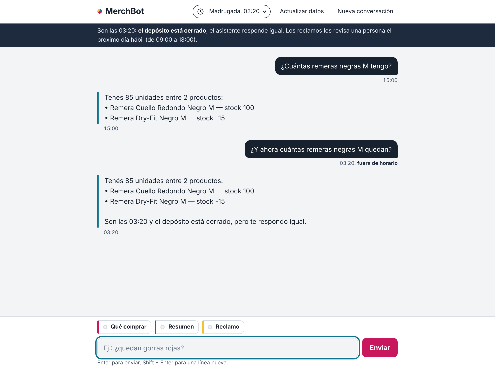
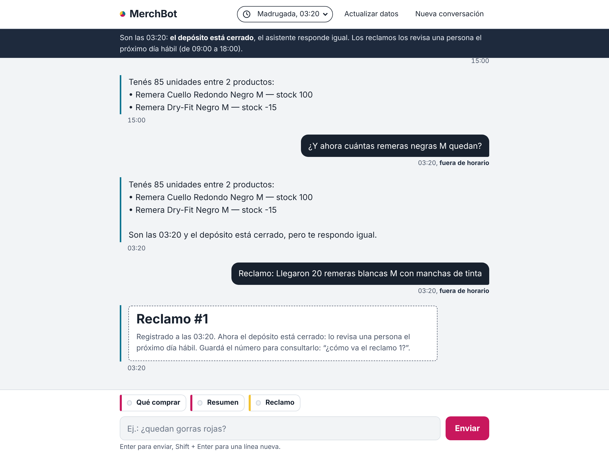
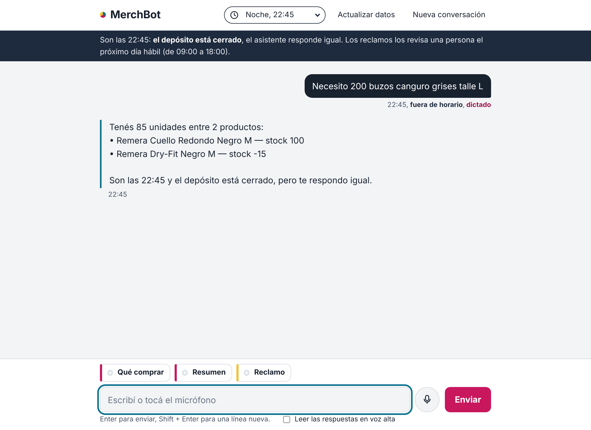
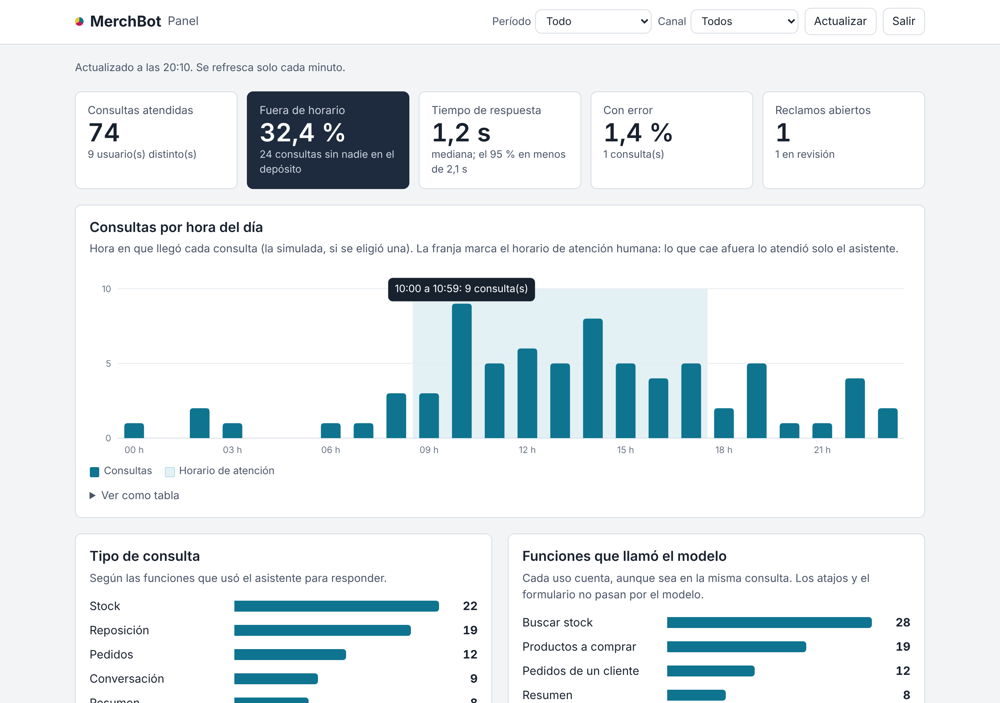
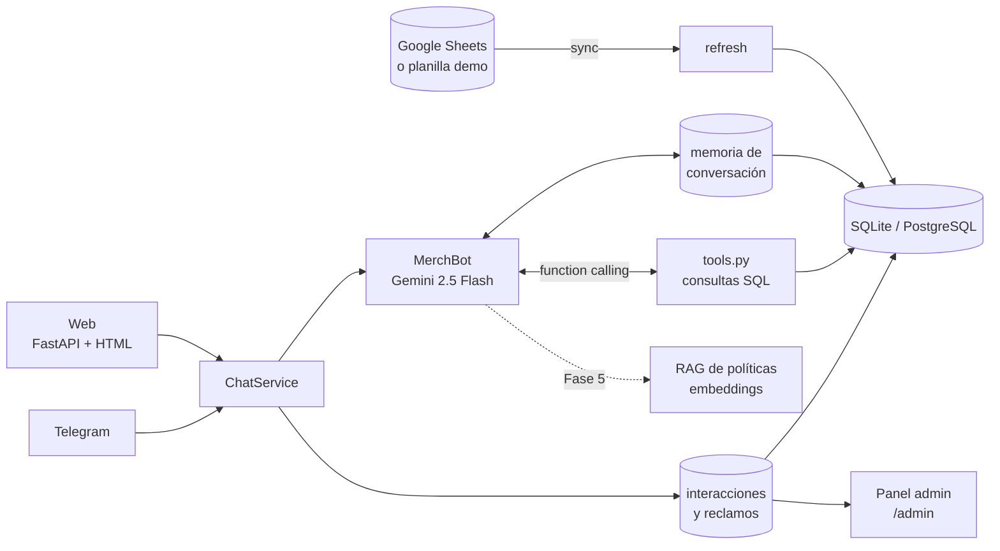

# MerchBot

**Asistente conversacional de inventario para una empresa de merchandising sublimado.** Se le pregunta en lenguaje natural por stock, pedidos y reposición, y responde con datos reales de la base. Los números salen de consultas SQL ejecutadas por *function calling*; el modelo solo redacta.

> Proyecto de portfolio y trabajo final de *Técnicas de Procesamiento del Habla* (Tecnicatura en Ciencia de Datos e IA, IFTS N°18). Nació como un bot de Telegram y hoy tiene interfaz web; está evolucionando a un asistente disponible 24/7, con voz, RAG y panel de métricas.



## Demo

```
vos:  cuántas remeras negras M tengo?
bot:  Tenés 100 unidades de Remera Cuello Redondo Negro M.

vos:  qué pidió Coca-Cola?
bot:  Coca-Cola - Evento Verano (15/04):
      • Remera Cuello Redondo Blanco M — 120 unidades
      • Remera Cuello Redondo Blanco L — 80 unidades
      • Gorra Con Respiración Rojo — 40 unidades

vos:  necesito 200 buzos canguro grises L para un evento
bot:  Hoy tenés 30 unidades de Buzo Canguro Gris L. No alcanzan para 200.
      Te paso alternativas con stock disponible:
      • Buzo Canguro Gris XL — 20 unidades
      • Buzo Cuello Redondo Gris L — 50 unidades
```

Los datos de ejemplo son ficticios (`data/Stock_Merchandising_Demo.xlsx`).

## Estado del proyecto

| | Funcionalidad | Estado |
|---|---|---|
| ✅ | Bot de Telegram con whitelist y anti-spam | Hecho |
| ✅ | Function calling contra SQLite (stock, pedidos, resumen, reposición) | Hecho |
| ✅ | Sincronización periódica desde Google Sheets | Hecho |
| ✅ | Paquete instalable, capa común `ChatService` (Fase 0) | Hecho |
| ✅ | Interfaz web (FastAPI + HTML), memoria persistente, datos de demo y Docker (Fase 1) | Hecho |
| ✅ | Registro de interacciones, hora simulada y reclamos (Fase 2) | Hecho |
| ✅ | Panel admin con métricas y gestión de reclamos (Fase 3) | Hecho |
| ✅ | Voz: dictado, normalización y lectura en voz alta (Fase 4) | Hecho |
| ✅ | 314 tests automatizados (Gemini mockeado) | Hecho |
| 🚧 | RAG de políticas y procedimientos | Fase 5 |
| 🚧 | Sentimiento y prioridad de reclamos | Fase 6 |
| 🚧 | Set de evaluación, login y rate limit web | Fase 7 |
| 🚧 | Deploy 24/7 en VPS | Fase 8 |

Detalle de cada fase en [`docs/PLAN_DE_FASES.md`](docs/PLAN_DE_FASES.md).

## Por qué está hecho así

- **El modelo no inventa números.** No se le pasa el catálogo en el prompt: Gemini decide qué función llamar (`buscar_stock`, `obtener_pedidos_de_cliente`, …), el código la ejecuta contra la base y el resultado vuelve al modelo, que arma la respuesta. Escala a miles de SKUs sin tocar el prompt.
- **Solo lectura sobre el negocio.** El bot no modifica stock ni pedidos; lo único que escribe son reclamos y el registro de interacciones. La fuente de verdad sigue siendo la planilla que ya usa la empresa.
- **El contexto lo pone el código, no el modelo.** Al registrar un reclamo, el canal, el usuario y la hora los completa el sistema; si el modelo intenta mandarlos, se descartan.
- **Sin migrar el sistema de nadie.** Sincroniza desde un Google Sheets compartido por el endpoint público de exportación: no necesita OAuth ni cuenta de Google Cloud.
- **Cada capa se puede reemplazar.** Todas las interfaces hablan con `ChatService`, que valida el mensaje y delega en el asistente. La web y Telegram son capas finas por encima; cambiar de modelo no toca las interfaces.
- **Se prueba sin nada externo.** Con `DATA_SOURCE=demo` carga una planilla de ejemplo, sin Google Sheets. Los atajos (qué comprar, resumen) no usan IA y responden aunque Gemini no esté disponible.
- **RAG solo donde corresponde (Fase 5).** El stock es dato estructurado y se consulta con SQL. Los embeddings se reservan para texto libre (políticas, preguntas frecuentes).

## Situaciones que atiende

| Situación | Ejemplo | Cómo la resuelve |
|---|---|---|
| Consulta de stock | "¿Cuántas remeras negras talle M tengo?" | `buscar_stock` sobre la base |
| Pedidos de un cliente | "¿Qué pidió Coca-Cola?" | `obtener_pedidos_de_cliente` |
| Reposición | "¿Qué hay que comprar?", "¿me alcanzan 200 buzos grises L?" | `listar_productos_a_comprar` y `buscar_stock` encadenadas |
| Reclamos | "Me llegaron remeras manchadas" y "¿cómo va el reclamo 1?" | `registrar_reclamo` y `consultar_estado_reclamo`, o el formulario |
| Resumen del inventario | "¿Cómo estamos?" | `obtener_resumen_ejecutivo` |

**Atención a cualquier hora.** En la web se elige la hora de la consulta (mañana, tarde, noche, madrugada u otra). El asistente sabe si el depósito está abierto: fuera del horario de atención responde igual y avisa que lo que necesite una persona (por ejemplo, un reclamo) queda para el próximo día hábil. Cada mensaje muestra su hora.

**Registro.** Cada consulta queda en la tabla `interacciones` con canal, hora, tipo de consulta, funciones usadas, duración y si hubo error. Los reclamos van a la tabla `reclamos` con un número para seguirlos.

Las conversaciones de ejemplo se generan con `python scripts/demo_dialogos.py` y quedan en `docs/DIALOGOS_DEMO.md`.



## Voz

Se le puede hablar al asistente: el botón del micrófono dicta la consulta y la respuesta se lee en voz alta. Lo dictado pasa por una normalización antes del modelo ("doscientos buzos talle ele" se convierte en "200 buzos talle L"), y cada consulta queda registrada como escrita o dictada. Usa la Web Speech API del navegador, así que no tiene costo ni necesita un servidor de audio; el detalle, la relación con la materia, las limitaciones y la privacidad están en [`docs/VOZ.md`](docs/VOZ.md).



## Panel de métricas

En `/admin`, con la clave `ADMIN_KEY` del `.env`, se ve cómo se usa el asistente: cuántas consultas atendió, qué porcentaje llegó fuera del horario de atención, tiempo de respuesta (mediana y percentil 95), errores, consultas por hora del día, tipos de consulta y funciones que llamó el modelo. Desde ahí también se cambia el estado de los reclamos y se filtra el registro de interacciones. Todos los números salen de consultas a la base, y hay tests que los comparan contra SQL directo.



<sub>La captura usa actividad generada para la prueba, no consultas reales.</sub>

## Arquitectura



Las líneas punteadas son partes planificadas.

**Flujo de una consulta**

1. El usuario escribe en la web (o en Telegram).
2. La web identifica la conversación con una cookie de sesión; Telegram verifica la whitelist y el rate limit.
3. `ChatService` valida el mensaje (vacío, largo máximo), resuelve la hora de la consulta (real o simulada) y lo pasa al asistente.
4. `MerchBot.ask()` envía la consulta a Gemini junto con las funciones disponibles y los últimos turnos guardados en la base.
5. Gemini pide ejecutar una o varias funciones; el código las corre contra la base.
6. Gemini redacta la respuesta con esos resultados y se devuelve al usuario.
7. `ChatService` registra la interacción: tipo de consulta, funciones usadas, hora y duración.

## Stack

| Capa | Tecnología |
|---|---|
| Lenguaje | Python 3.11 |
| LLM | Google Gemini 2.5 Flash (`google-genai`) con function calling |
| Interfaz web | FastAPI + uvicorn, HTML y JavaScript sin framework |
| Telegram | python-telegram-bot 21 |
| Base de datos | SQLite (desarrollo) / PostgreSQL (producción), SQLAlchemy 2.0 |
| Datos | Google Sheets (endpoint público, `requests`) o planilla de demo (`openpyxl`) |
| Tareas periódicas | APScheduler |
| Configuración | pydantic-settings |
| Tests | pytest, pytest-asyncio, TestClient de FastAPI |
| Deploy | Docker y docker compose |
| Voz | Web Speech API del navegador (reconocimiento y síntesis) |
| Previsto | embeddings de Gemini, `transformers` |

## Funciones que el modelo puede llamar

| Función | Para qué |
|---|---|
| `buscar_stock` | Stock por producto, modelo, color y talle |
| `listar_productos_a_comprar` | Productos con stock en cero o negativo, ordenados por urgencia |
| `obtener_pedidos_de_cliente` | Pedidos de un cliente (búsqueda parcial) |
| `listar_pedidos_recientes` | Últimos N pedidos |
| `obtener_resumen_ejecutivo` | Métricas agregadas de stock y pedidos |
| `listar_categorias_disponibles` | Catálogo disponible |
| `registrar_reclamo` | Registra un reclamo y devuelve su número |
| `consultar_estado_reclamo` | Estado de un reclamo por número |

## Cómo correrlo

Lo único obligatorio es una API key de [Google AI Studio](https://aistudio.google.com/app/apikey). Sin Google Sheets, MerchBot usa la planilla de demo.

### Con Docker (recomendado)

```bash
git clone https://github.com/agustinvignau/merchbot.git
cd merchbot
cp .env.example .env            # completá GEMINI_API_KEY
docker compose up -d --build
```

Abrí <http://localhost:8000>. La base queda en un volumen, así que la conversación sobrevive a reinicios.

### Sin Docker

Requiere Python 3.11 o superior.

```bash
python -m venv venv
source venv/bin/activate        # Windows: venv\Scripts\activate
pip install -e ".[dev]"
cp .env.example .env            # Windows: copy .env.example .env  → completá GEMINI_API_KEY
python -m merchbot              # o simplemente: merchbot
```

### Comandos

| Comando | Qué hace |
|---|---|
| `merchbot` o `merchbot web` | Interfaz web en <http://localhost:8000> (`--port` para cambiarlo) |
| `merchbot telegram` | Bot de Telegram |
| `merchbot cargar-demo` | Carga la planilla de ejemplo en la base |
| `python scripts/test_bot_interactive.py` | Conversar con el bot desde la terminal |
| `python scripts/test_sync.py` | Probar la sincronización con Google Sheets |

### Horario de atención

Se configura en `.env`: `TIMEZONE`, `ATENCION_DESDE`, `ATENCION_HASTA` y `ATENCION_DIAS` (0 = lunes). Por defecto, lunes a viernes de 09:00 a 18:00, hora de Buenos Aires.

### Datos reales con Google Sheets

1. Subí `data/Stock_Merchandising_Demo.xlsx` a Google Drive y abrilo como Hojas de cálculo (o copiá su estructura: hojas `Stock` y `Pedidos`).
2. **Compartir → Cualquiera con el enlace → Lector** y copiá el ID de la URL.
3. Poné `SHEETS_ID=...` en `.env`. Con `DATA_SOURCE=auto` (por defecto) pasa a usar Sheets y sincroniza cada `SYNC_INTERVAL_MIN` minutos.

### API web

| Método y ruta | Qué hace |
|---|---|
| `POST /api/chat` | Envía `{"message": "...", "hora": "03:20", "origen": "voz"}` (hora y origen opcionales) y devuelve la respuesta, la consulta procesada, la hora y si es fuera de horario |
| `GET /api/historial` | Conversación guardada de esta sesión |
| `DELETE /api/historial` | Empieza una conversación nueva |
| `GET /api/comprar` | Productos para reponer (sin IA) |
| `GET /api/resumen` | Resumen del inventario (sin IA) |
| `POST /api/reclamos` | Registra un reclamo desde el formulario |
| `GET /api/reclamos/{numero}` | Estado de un reclamo |
| `GET /api/horario` | Hora real y horario de atención |
| `POST /api/sync` | Vuelve a cargar los datos |
| `GET /health` | Estado del servicio |
| `POST /api/admin/login` | Ingreso al panel con `{"clave": "..."}` |
| `GET /api/admin/metricas` | Métricas (`dias`, `todo`, `canal`) |
| `GET /api/admin/interacciones` | Registro con filtros (`tipo`, `canal`, `fuera_de_horario`, `errores`) |
| `GET /api/admin/reclamos` | Reclamos, opcionalmente por `estado` |
| `PATCH /api/admin/reclamos/{numero}` | Cambia el estado (`abierto`, `en_revision`, `resuelto`) |

Las rutas `/api/admin` piden la cookie del panel o el header `X-Admin-Key`.

La documentación interactiva queda en <http://localhost:8000/docs>.

### Telegram (opcional)

1. Creá un bot con [@BotFather](https://t.me/BotFather) y poné el token en `TELEGRAM_BOT_TOKEN`.
2. Arrancá con `merchbot telegram` (o `docker compose --profile telegram up -d`).
3. Escribile `/whoami`, copiá tu ID a `TELEGRAM_ALLOWED_USER_IDS` y reiniciá. **Sin whitelist, cualquiera que encuentre el bot puede ver el stock y los clientes.**

Comandos: `/start`, `/help`, `/whoami`, `/sync`, `/comprar`, `/resumen`, `/clear`, `/reclamo <qué pasó>`.

## Tests

```bash
pytest
```

314 tests. Usan SQLite en memoria y mockean Gemini, así que no consumen cuota ni requieren claves.

## Estructura

```
merchbot/
├── src/merchbot/
│   ├── __main__.py              # punto de entrada (python -m merchbot)
│   ├── config.py                # variables de entorno (pydantic-settings)
│   ├── timeutils.py             # fechas en UTC con zona horaria
│   ├── core/
│   │   ├── chat_service.py      # puerta de entrada común a todas las interfaces
│   │   ├── memory.py            # memoria de conversación (RAM o base)
│   │   ├── horario.py           # hora real o simulada, horario de atención
│   │   ├── registro.py          # registro de interacciones
│   │   ├── metricas.py          # métricas del panel
│   │   ├── normalizacion.py     # números y talles dictados → forma de los datos
│   │   ├── assistant.py         # MerchBot: Gemini + loop de function calling
│   │   ├── tools.py             # funciones que llama el modelo (consultas SQL)
│   │   └── reports.py           # reportes directos sin IA (/comprar, /resumen)
│   ├── data/
│   │   ├── models.py            # StockItem, Pedido, Mensaje, Interaccion, Reclamo
│   │   ├── database.py          # engine y sesiones SQLAlchemy
│   │   ├── sheets_sync.py       # lectura del Sheets y upsert
│   │   ├── demo_seed.py         # carga de la planilla de demo
│   │   ├── refresh.py           # elige la fuente según DATA_SOURCE
│   │   └── scheduler.py         # sync periódico
│   ├── interfaces/
│   │   ├── web/                 # app.py y admin.py (FastAPI), static/ (chat y panel)
│   │   └── telegram/            # bot.py (handlers) y formatters.py
│   └── security/
│       └── rate_limiter.py      # anti-spam
├── tests/                       # espejo de src/merchbot (core, data, interfaces, security)
├── scripts/                     # REPL, prueba de sync y guion de diálogos de demo
├── data/                        # plantilla de demo y script que la genera
├── docs/
│   ├── PLAN_DE_FASES.md         # hoja de ruta detallada
│   ├── VOZ.md                   # cómo funciona la voz, límites y privacidad
│   ├── img/                     # capturas
│   └── Propuesta_MerchBot.pdf
├── Dockerfile
├── docker-compose.yml
├── pyproject.toml
└── LICENSE
```

## Seguridad

- **Panel:** protegido con `ADMIN_KEY`; sin clave queda deshabilitado. La cookie del panel es `HttpOnly` y `SameSite=Strict`, y es un HMAC de la clave, no la clave.
- **Web:** cada navegador tiene su conversación, identificada por una cookie `HttpOnly` con un ID aleatorio. El servidor escucha solo en `localhost` por defecto, y en Docker el puerto se publica solo en `127.0.0.1`. Los errores internos no se muestran al usuario.
- **Telegram:** acceso por whitelist de IDs y rate limit para usuarios no autorizados, con registro de cada intento denegado.
- El bot no escribe en el Sheets ni modifica stock o pedidos.
- Las claves se leen del entorno y nunca se versionan (`.env` está en `.gitignore`).
- El contenedor corre con un usuario sin privilegios.

## Limitaciones actuales

- **El chat todavía no tiene login** y el panel usa una sola clave compartida. Está pensado para correr en tu máquina; no lo expongas a internet hasta la Fase 7 (login y rate limit web).
- Corre en una PC local, así que no es 24/7 real hasta la Fase 8.
- La reducción de alucinaciones depende del prompt y de que los datos salgan de funciones; no es cero. La Fase 7 mide la tasa de aciertos con un set de evaluación.
- Los datos de demo son ficticios; no hay datos de clientes reales en el repositorio.

## Contexto académico

Trabajo final de *Técnicas de Procesamiento del Habla* — Tecnicatura Superior en Ciencia de Datos e Inteligencia Artificial, IFTS N°18. Consigna: un chatbot que simule atención 24/7 con al menos cuatro situaciones cotidianas, registro de interacciones o reclamos, simulación de atención a cualquier hora y una reflexión final sobre el valor de la atención continua.

La reflexión final se publicará en `docs/REFLEXION.md` al cerrar la Fase 8.

## Autor

**Agustín Vignau** — Analista de datos junior, Buenos Aires, Argentina.
[agustinvignau.com](https://agustinvignau.com) · [GitHub](https://github.com/agustinvignau)

## Licencia

MIT
