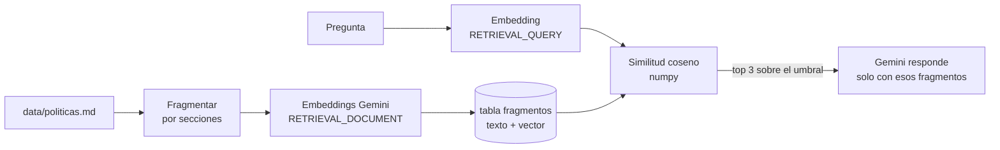

# RAG de políticas

El asistente responde preguntas de procedimientos (plazos, pedido mínimo, cambios, talles, envíos, formatos de logo, cuidado de prendas) buscando en un documento de políticas en vez de inventar. Es la parte que cubre el requisito del TP de **guiar al usuario en procedimientos simples**.

## Por qué RAG acá y no sobre el stock

| Tipo de dato | Ejemplo | Cómo se consulta |
|---|---|---|
| Estructurado | Stock por talle y color, pedidos por cliente | **SQL** con function calling. Es exacto: "¿cuántas remeras negras M?" tiene una sola respuesta correcta. |
| Texto libre | "Los productos personalizados no tienen cambio salvo falla de producción..." | **RAG**: buscar los fragmentos relevantes y que el modelo responda con ellos. |

Meter el stock en embeddings sería peor: la similitud semántica no distingue bien "M" de "L" ni suma unidades. Por eso conviven las dos cosas y el modelo elige: `buscar_stock` para datos y `consultar_politicas` para procedimientos. Una pregunta como "¿cuánto tardan 150 remeras blancas M?" puede usar las dos.

## Cómo funciona

1. **Fragmentación** (`core/rag/fragmentos.py`). Cada sección `##` del documento es un fragmento; si es muy larga se parte por párrafos y cada parte conserva el título.
2. **Indexación** (`core/rag/indice.py`). Los fragmentos se guardan en la tabla `fragmentos` con un hash de su texto. Volver a indexar solo procesa lo que cambió: si editás una sección, se recalcula el embedding de esa sección y nada más. Si cambia el modelo de embeddings, se recalculan todos.
3. **Embeddings** (`core/rag/embeddings.py`). `gemini-embedding-001` con 768 dimensiones, tipo de tarea distinto para documentos y para preguntas, y vectores normalizados.
4. **Búsqueda**. Similitud de coseno con numpy: con vectores normalizados es un producto punto. Se devuelven hasta 3 fragmentos que superen el umbral (`RAG_MIN_SCORE`, 0,55 por defecto). Si ninguno lo supera, la función devuelve "no encontrado" y el modelo dice que no tiene esa información.
5. **Respuesta**. El modelo responde solo con lo que dicen los fragmentos y nombra la sección. La web muestra debajo de la respuesta "Según las políticas: ...", con las secciones usadas.

No hace falta una base vectorial (pgvector, Chroma): con una docena de fragmentos, cargar los vectores y multiplicar una matriz lleva microsegundos. Si el documento creciera a miles de fragmentos, ese sería el cambio.

## Respaldo léxico (BM25)

Si no hay `GEMINI_API_KEY`, o la API de embeddings falla, la búsqueda pasa a **BM25** (`core/rag/lexico.py`): el algoritmo clásico de recuperación por palabras, con stopwords en español, sin tildes, una reducción simple de plurales y una lista corta de sinónimos frecuentes ("tarda" → "plazo", "lavar" → "cuidado"). Así el asistente sigue funcionando sin internet y hay una línea de base contra la cual medir los embeddings.

## Evaluación

`python scripts/evaluar_rag.py --salida docs/EVALUACION_RAG.md` corre 25 preguntas escritas como las haría un usuario (22 con respuesta en las políticas y 3 fuera de tema) y mide:

- **acierto@1**: la sección correcta salió primera.
- **acierto@3**: está entre las 3 primeras, que son las que recibe el modelo.
- **MRR**: promedio de 1/posición de la sección correcta.
- **rechazo**: en preguntas fuera de tema, que no devuelva nada.

Resultado de la búsqueda léxica (sin API key):

| Método | Acierto@1 | Acierto@3 | MRR | Rechazo |
|---|---|---|---|---|
| Léxica (BM25 + sinónimos) | 73 % | 95 % | 0,82 | 100 % |

La semántica se evalúa al correr el script con `GEMINI_API_KEY`; el reporte completo queda en `docs/EVALUACION_RAG.md`. Los fallos de la léxica son justamente los que motivan los embeddings: "¿Puedo ver cómo queda una prenda antes de encargar 300?" no comparte palabras con la sección "Muestras", y "¿Puedo pedir solo 5 remeras?" no dice "mínimo".

Los sinónimos no se ajustaron mirando el set de evaluación: agregar una regla por cada pregunta que falla mejoraría el número pero no la búsqueda real.

## Cambiar las políticas

1. Editá `data/politicas.md` (o apuntá `POLITICAS_PATH` a otro archivo). Usá una sección `##` por tema.
2. Corré `merchbot indexar-politicas`. La app también indexa sola al arrancar.
3. Si agregaste temas nuevos, sumá preguntas a `scripts/evaluar_rag.py` y volvé a medir.

## Relación con la materia

- **Embeddings y similitud semántica**: representación vectorial del texto, la misma idea que BERT (TP4) pero con un modelo de embeddings actual.
- **Recuperación de información y preprocesamiento**: tokenización, stopwords y raíces en el respaldo BM25, en la línea de NLTK (TP3).
- **Comparativa de métodos** (Unidad 7): léxico contra semántico, medido con las mismas preguntas.
