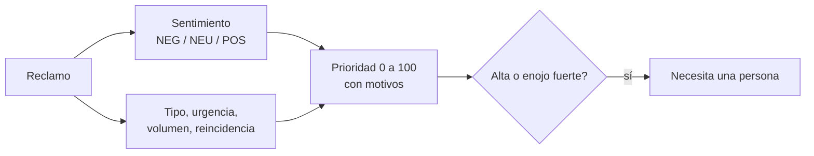

# Sentimiento y prioridad de reclamos

Cada reclamo se analiza al registrarse: se estima su **tono** (negativo, neutro o positivo) y se calcula una **prioridad** de 0 a 100 con sus motivos. El panel ordena los reclamos por prioridad y marca los que conviene que vea una persona primero. Es la parte del proyecto que conecta con el TP3 (NLTK y análisis de sentimiento) y el TP4 (BERT).

## Cómo se calcula



**Sentimiento.** Dos motores con la misma interfaz (`core/sentimiento.py`):

| Motor | Qué es | Cuándo se usa |
|---|---|---|
| Léxico propio | Diccionario en español rioplatense con negación ("no está bien"), intensificadores ("muy", "re", "!!!") y atenuantes ("nada grave"). Explica qué palabras pesaron. | Por defecto, sin dependencias |
| RoBERTuito (`pysentimiento/robertuito-sentiment-analysis`) | Modelo tipo BERT (RoBERTa) entrenado con tuits en español, del grupo de pysentimiento (UBA). Clasifica en NEG, NEU y POS. | Si se instala con `pip install -e ".[nlp]"` |

Con `SENTIMIENTO_MOTOR=auto` se usa RoBERTuito si está instalado y el modelo carga; si no, el léxico.

**Prioridad** (`core/prioridad.py`). Suma señales simples, cada una con su motivo visible en el panel:

| Señal | Aporte |
|---|---|
| Tipo: producto fallado o error en el pedido / faltante / demora / otro | +25 / +20 / +15 / +5 |
| Tono negativo | +15 a +40 según la intensidad |
| Tono positivo ("gracias, solo aviso…") | −10 |
| Urgencia: "urgente", "hoy", "mañana", "evento", "cuanto antes"… | +20 |
| Volumen: 100 unidades o más / 20 o más | +15 / +8 |
| Reincidencia: "otra vez", "segunda vez", "sigo esperando" | +10 |

Alta desde 60, media desde 35. Un reclamo **necesita una persona** si es de prioridad alta o si el tono es muy negativo (−0,6 o menos), aunque no llegue a alta. El asistente avisa al usuario que su reclamo quedó como prioritario, sin mostrarle el puntaje.

Se eligió una suma explicable y no un modelo entrenado porque con pocos reclamos no hay datos para entrenar, y porque quien atiende tiene que poder entender (y discutir) por qué un reclamo quedó arriba.

## Por qué no VADER

VADER es el analizador de sentimiento que trae NLTK (el que se usó en el TP3). Su diccionario es en inglés: en español solo reconoce palabras que coinciden ("horrible") y deja casi todo como neutro. "Llegaron 20 remeras con manchas, un desastre" le da puntaje 0. Se incluye en la evaluación para mostrarlo con números.

## Evaluación

`python scripts/evaluar_sentimiento.py --salida docs/EVALUACION_SENTIMIENTO.md` compara los motores sobre `data/evaluacion/reclamos_etiquetados.csv`: 24 reclamos escritos y etiquetados a mano con el sentimiento y la prioridad que esperaríamos.

| Motor | Exactitud sentimiento | F1 macro | Exactitud prioridad |
|---|---|---|---|
| Léxico propio | 88 % | 0,90 | 79 % |
| VADER (léxico en inglés) | 42 % | 0,30 | 42 % |
| RoBERTuito | se mide al instalar `.[nlp]` | | |

Hay que leer estos números con cuidado:

- El set es chico y lo escribimos nosotros, igual que el diccionario. El set se escribió antes que el diccionario y después solo se corrigieron dos errores generales (el redondeo del umbral y la negación que cruzaba comas), pero igual es probable que el léxico rinda menos con reclamos reales.
- RoBERTuito se entrenó con tuits, no con reclamos de una empresa: hay que medirlo, no suponerlo.
- La prioridad "esperada" es una opinión. Los desacuerdos son buenos ejemplos para discutir en la defensa: "Pedí talle L y vinieron todas M" quedó neutro y de prioridad baja (no tiene ninguna palabra de enojo, pero es un error del pedido), y "Les escribo para cambiar el color… que todavía no salió" quedó negativo por la frase "todavía no".

Para mejorar el set, conviene sumar reclamos reales (anonimizados) y que los etiquete más de una persona.

## Instalar el modelo

```bash
pip install -e ".[nlp]"          # transformers + PyTorch (varios cientos de MB)
python scripts/evaluar_sentimiento.py
```

La primera vez descarga el modelo de Hugging Face (unos 400 MB). En la imagen de Docker no se incluye para mantenerla liviana: ahí se usa el léxico.

## Limitaciones

- Frases que no están en el diccionario ("en vez de", ironía, sarcasmo) se pueden leer como neutras.
- El análisis es por reclamo, no por conversación: no detecta que alguien ya reclamó lo mismo por otro canal.
- Los reclamos registrados antes de esta versión no tienen prioridad: aparecen al final, con un guion.
