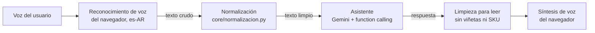

# Voz en MerchBot

MerchBot se puede usar hablando: se le dicta la consulta y lee la respuesta en voz alta. Este documento explica cómo funciona, qué decisiones se tomaron y qué limitaciones tiene.

## El recorrido de una consulta por voz

1. **Reconocimiento (voz → texto).** El botón del micrófono usa la Web Speech API del navegador (`SpeechRecognition`) en español de Argentina. Mientras hablás, el texto parcial aparece en el cuadro de mensaje; cuando terminás, se envía solo.
2. **Normalización.** Lo dictado llega como se escucha: "doscientos buzos talle ele". El servidor lo lleva a la forma en que están los datos: "200 buzos talle L". Se aplica solo a lo dictado (la web manda `origen: "voz"`); lo escrito no se toca.
3. **Asistente.** La consulta normalizada sigue el mismo camino que una escrita: Gemini elige las funciones, el código consulta la base y el modelo redacta.
4. **Síntesis (texto → voz).** La respuesta se lee con `speechSynthesis`, eligiendo una voz en español (primero es-AR, después es-419, es-US, es-MX, es-ES). Antes se quitan viñetas, marcas de formato y los códigos SKU entre paréntesis, que leídos en voz alta no aportan.

Si la consulta fue dictada, la respuesta se lee siempre. Si fue escrita, solo cuando está tildado "Leer las respuestas en voz alta".

## Normalización del dictado

Es un paso clásico de preprocesamiento de texto: tokenizar, reconocer patrones y reescribirlos. Las reglas están en `src/merchbot/core/normalizacion.py` y tienen tests en `tests/core/test_normalizacion.py`.

| Regla | Ejemplo | Resultado |
|---|---|---|
| Números en palabras | "doscientos cincuenta buzos" | "250 buzos" |
| Números con "y" | "treinta y cinco remeras" | "35 remeras" |
| Miles | "mil quinientas tazas" | "1500 tazas" |
| Talles después de "talle" | "talle ele", "talle equis ele" | "talle L", "talle XL" |
| Talles después de "en" | "¿y en eme?" | "¿y en M?" |
| Letras en minúscula | "talle m" | "talle M" |

Casos que **no** se tocan a propósito:

- "una remera", "un evento": "un/una" sueltos son artículos, no números.
- "remeras y buzos": la "y" solo une decena y unidad ("treinta y cinco").
- "¿hay algo en ese color?": después de "en", "ese" casi siempre es demostrativo, no el talle S.
- "elegí el modelo": "ele" dentro de otra palabra no es un talle.

En la web, la burbuja del usuario muestra la consulta ya normalizada y la marca "dictado"; pasando el mouse se ve lo que se escuchó originalmente. En el panel, cada interacción guarda su origen (`texto` o `voz`) y hay una cifra con el porcentaje de consultas dictadas.

## Relación con la materia

| Tema de la cursada | Dónde aparece |
|---|---|
| Reconocimiento de voz (Unidad 4) | Dictado con `SpeechRecognition`, resultados parciales y finales |
| Síntesis de voz (Unidad 4) | Lectura con `speechSynthesis` y selección de voz por idioma |
| Preprocesamiento de texto, tokenización (Unidad 3, NLTK) | Normalización de números y talles antes del modelo |
| Asistentes virtuales (Unidad 6) | El circuito completo voz → texto → asistente → voz |
| Comparativa de modelos (Unidad 7) | Ver "Alternativas" más abajo |

## Privacidad y limitaciones

- **Dónde se procesa el audio.** La Web Speech API no garantiza que el reconocimiento sea local. En Chrome y Edge el audio se envía a los servidores del proveedor del navegador para transcribirlo; en Safari se usa el servicio de Apple. MerchBot nunca recibe ni guarda audio: solo le llega el texto. Conviene aclararlo si se usa con datos reales.
- **Navegadores.** El dictado funciona en Chrome, Edge y Safari. Firefox no tiene `SpeechRecognition`: en ese caso el botón del micrófono no aparece y la web lo avisa. La lectura en voz alta funciona en todos los navegadores modernos.
- **Conexión.** En Chrome el dictado necesita internet.
- **Permiso del micrófono.** El navegador lo pide la primera vez. Si se niega, la web explica cómo habilitarlo. Fuera de `localhost`, los navegadores solo dan acceso al micrófono en páginas con HTTPS (lo resuelve el deploy de la Fase 8).
- **Calidad.** Depende del micrófono, el ruido y el acento. Nombres propios de clientes o modelos raros pueden transcribirse mal; la normalización no corrige esos casos.
- **Telegram.** Las notas de voz de Telegram no se procesan todavía.

## Alternativas evaluadas

| Opción | Ventaja | Por qué no (por ahora) |
|---|---|---|
| Web Speech API (elegida) | Sin costo, sin backend, funciona en el celular | El audio lo procesa el proveedor del navegador; no anda en Firefox |
| Whisper local (`openai-whisper` o `faster-whisper`) | Audio que no sale de la máquina, muy buena calidad en español | Requiere subir el audio al servidor y bastante CPU o GPU; sumaría un endpoint de audio |
| API de voz en la nube (Google Cloud Speech, Azure) | Calidad alta, modelos para es-AR | Costo por minuto y cuenta en la nube |
| Gemini con audio directo | Un solo modelo para entender audio y responder | Mezcla transcripción y respuesta: se pierde el texto intermedio y la normalización controlada |

Si el proyecto pasa a producción con datos reales, el siguiente paso natural es Whisper local para que el audio no salga del servidor.
